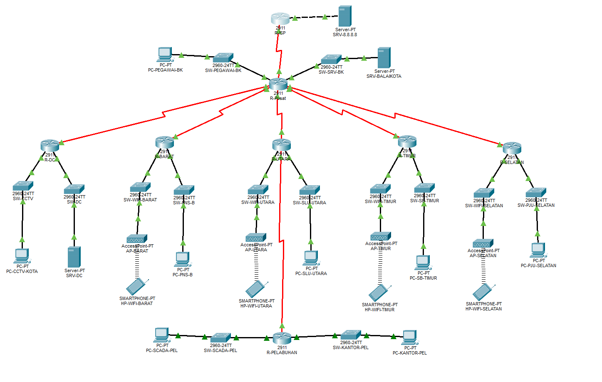
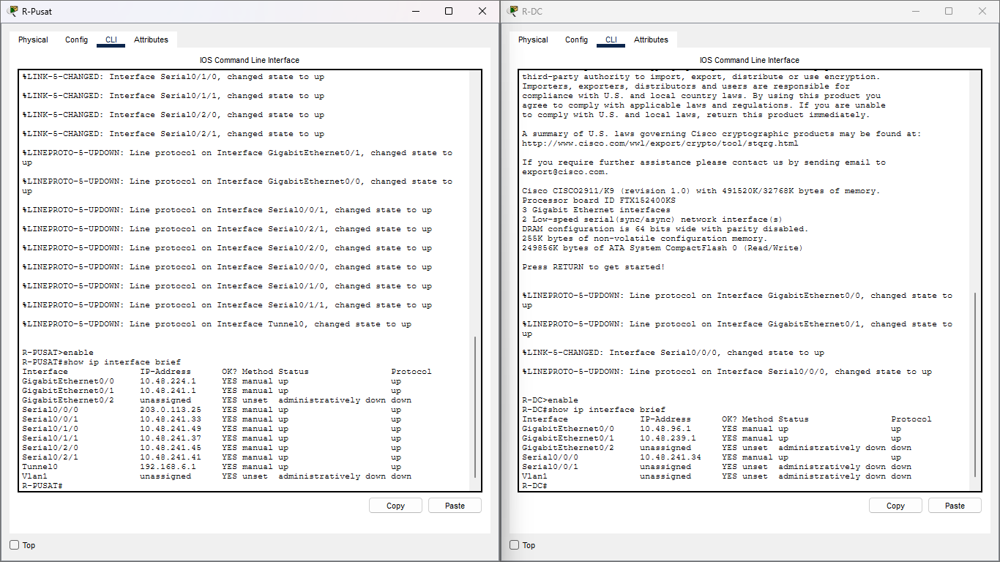
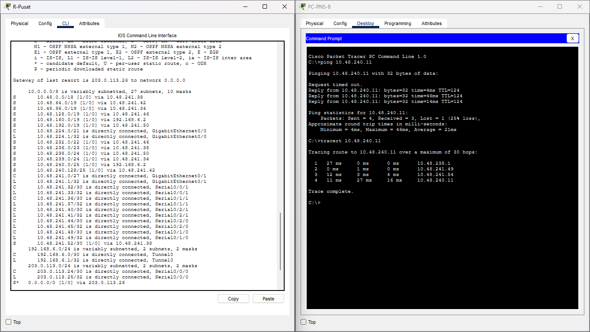
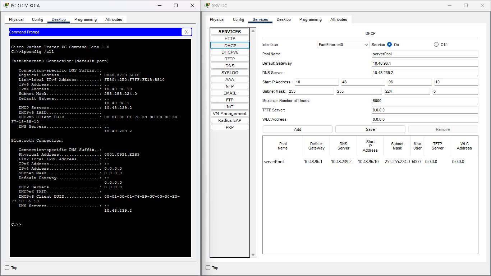
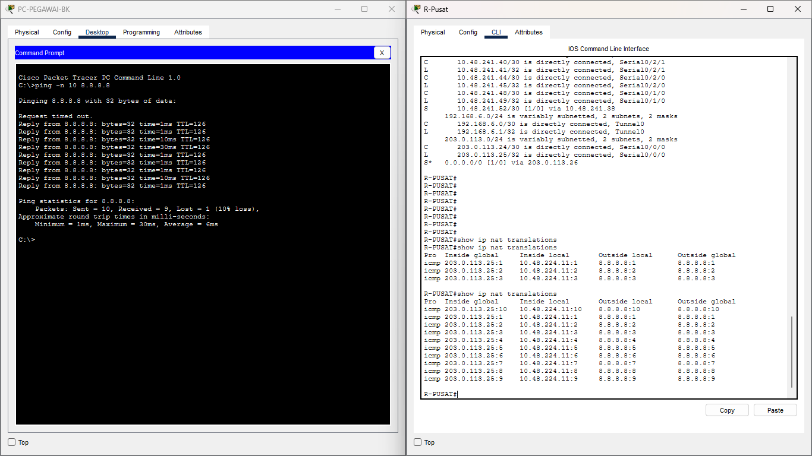
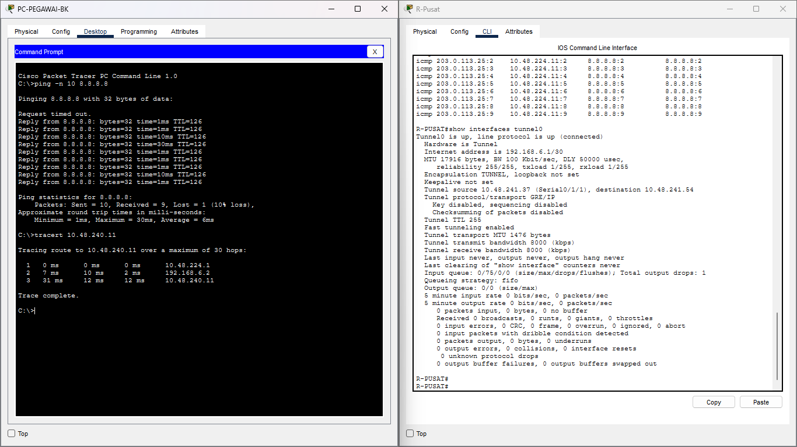
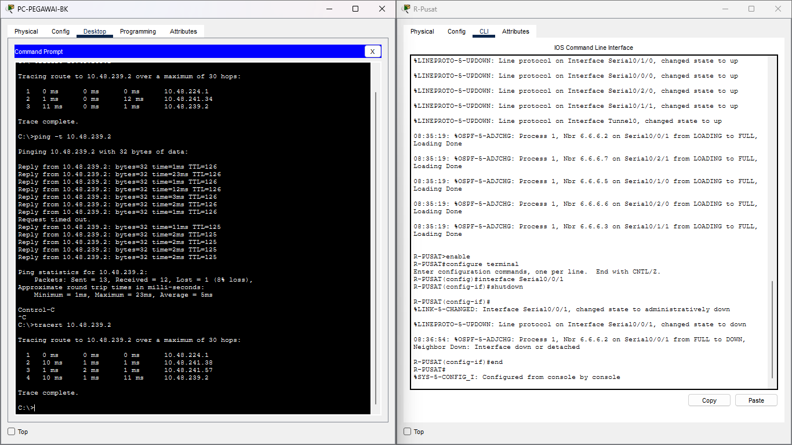

# Mid-Project Jaringan Komputer — Desain & Implementasi Jaringan Smart City Surabaya (Kelompok 6)

Repositori ini berisi dokumentasi lengkap, perancangan pengalamatan IP (VLSM & CIDR), konfigurasi perangkat jaringan, serta bukti pengujian *end-to-end* untuk studi kasus **Jaringan Terpadu Smart City Surabaya** menggunakan **Cisco Packet Tracer**.

---

## Daftar Isi
1. [Identitas Kelompok & Pembagian Tugas](#1-identitas-kelompok--pembagian-tugas)
2. [Desain Topologi Jaringan](#2-desain-topologi-jaringan)
3. [Alasan Pemilihan Skema Subnetting (VLSM & CIDR) serta Revisi UTS](#3-alasan-pemilihan-skema-subnetting-vlsm--cidr-serta-revisi-uts)
4. [Tabel Alokasi Alamat IP (14 LAN & 7 Link Backbone)](#4-tabel-alokasi-alamat-ip-14-lan--7-link-backbone)
5. [Penjelasan Seluruh Konfigurasi](#5-penjelasan-seluruh-konfigurasi)
6. [Bukti Pengujian Mandiri (Soal 1 – Soal 8)](#6-bukti-pengujian-mandiri-soal-1--soal-8)
7. [Daftar Berkas dalam Repositori](#7-daftar-berkas-dalam-repositori)

---

## 1. Identitas Kelompok & Pembagian Tugas

* **Kelompok:** 6 (`K = 6`)
* **Blok Alamat Privat Utama:** `10.48.0.0/16` (Oktet ke-2 = $8 \times 6 = 48$)
* **Domain Internal:** `k6.smartcity.lab`
* **Tautan Video Demonstrasi:** `[Masukkan Link YouTube / Google Drive di sini]`

| Peran | Anggota | Tanggung Jawab Utama |
| :--- | :--- | :--- |
| **Role A** | **Rayhan Fadhilah Allayn - 5027251126** | Desain topologi base & pelabelan 14 LAN, penyusunan tabel Excel VLSM/CIDR & revisi UTS, konfigurasi DHCP Server (`SRV-DC`), serta seluruh layanan aplikasi server (DNS, HTTP, FTP, Email). |
| **Role B** | **Rido Patra Yudhistira Edwin - 5027251120** | Konfigurasi `R-DC`, `R-BARAT`, `R-TIMUR`, dan `R-SELATAN` (gateway, static routing, DHCP server, DHCP relay CCTV), migrasi dynamic routing OSPF & link cadangan `L7` pada router cabang, penggabungan (*merge*) file final `.pkt`, penyelarasan server, pengujian failover, dan penyusunan dokumentasi teknis. |
| **Role C** | **Mahrinza Redouane Zakariyah - 5027251074** | Konfigurasi `R-ISP`, `R-PUSAT`, `R-UTARA`, dan `R-PELABUHAN` (gateway, static routing, NAT Overload/PAT, Tunnel GRE, DHCP wilayah pusat/utara/pelabuhan), serta migrasi OSPF pada core & backbone. |

---

## 2. Desain Topologi Jaringan

### Arsitektur & Hierarki Jaringan
Topologi dirancang menggunakan arsitektur **Hub-and-Spoke dengan Redundansi Backbone** yang menghubungkan pusat pemerintahan (Balai Kota) dengan Data Center, wilayah operasional (Utara, Selatan, Timur, Barat), serta kawasan strategis Pelabuhan:

1. **Core Layer (`R-PUSAT`):** Bertindak sebagai pusat interkoneksi seluruh jaringan internal dan gerbang keluar menuju Internet (`R-ISP` melalui link serial WAN `203.0.113.24/30`).
2. **Distribution & Regional Layer:**
   * **`R-DC` (Data Center):** Menampung server pusat (`SRV-DC`) dan jaringan pengawasan `CCTV Kota`, terhubung langsung ke `R-PUSAT` via **Link L1**.
   * **`R-UTARA` & `R-PELABUHAN`:** `R-UTARA` terhubung ke `R-PUSAT` via **Link L2** dan menjadi router perantara menuju `R-PELABUHAN` melalui **Link L6**.
   * **`R-SELATAN`, `R-TIMUR`, `R-BARAT`:** Masing-masing terhubung langsung ke `R-PUSAT` melalui **Link L3**, **Link L4**, dan **Link L5**.
3. **Redundant Link (`L7` — Khusus `K6_VLSM_OSPF.pkt`):** Jalur serial cadangan antara `R-DC` dan `R-UTARA` (`10.48.241.56/30`) yang diaktifkan pada skenario OSPF untuk menjamin *failover* otomatis apabila link utama `L1` atau `L2` terputus.
4. **Access Layer (14 Segmen LAN):** Setiap segmen menggunakan *switch* terpisah untuk mengisolasi domain *broadcast*, dilengkapi 4 *Access Point* dengan *MAC allow-list* untuk segmen WiFi publik di tiap wilayah.

*(Detail pemetaan port dan jenis kabel lengkap tersedia pada berkas [`wiring.md`](wiring.md)).*

---

## 3. Alasan Pemilihan Skema Subnetting (VLSM & CIDR) serta Revisi UTS

### 3.1 Mengapa Menggunakan Kombinasi VLSM dan CIDR?
* **Variable Length Subnet Mask (VLSM):** Kebutuhan host pada 14 LAN sangat bervariasi—mulai dari **11.000 host** (`WiFi Publik Utara`, `/18`) hingga **20 host** (`Server Balai Kota`, `/27`) dan **2 host** untuk masing-masing link *point-to-point* (`/30`). Dengan mengurutkan alokasi dari kebutuhan terbesar ke terkecil tanpa celah, total penggunaan ruang alamat hanya **61.756 alamat** dari kapasitas `10.48.0.0/16` (65.536 alamat), sehingga tidak terjadi pemborosan IP seperti pada *subnetting* ukuran tetap (*FLSM*).
* **Classless Inter-Domain Routing (CIDR / Route Summarization):** Pengalokasian blok dilakukan secara berurutan sehingga memungkinkan agregasi rute (*supernetting*) yang bersih pada setiap router regional dan mempermudah proses *filtering* pada NAT (`access-list 1 permit 10.48.0.0 0.0.255.255`).

### 3.2 Koreksi & Revisi dari Lembar Kerja UTS
Berdasarkan evaluasi rancangan awal UTS terhadap standar RFC dan spesifikasi topologi:
1. **Perbaikan Blok IP Privat (`192.48.x.x` $\rightarrow$ `10.48.x.x`):** Alamat `192.48.0.0/16` bukan merupakan ruang alamat privat menurut **RFC 1918** (blok privat Kelas C hanya `192.168.0.0/16`). Sesuai ketentuan kelompok (`K = 6`), seluruh jaringan internal dipindahkan ke blok privat Kelas A **`10.48.0.0/16`**.
2. **Koreksi Kesalahan Hitung Broadcast UTS:** Memperbaiki kesalahan penulisan batas oktet pada lembar UTS (`242.11` $\rightarrow$ `242.31`, `200.128` $\rightarrow$ `200.127`, dan `97.285` $\rightarrow$ `97.255` yang melebihi nilai maksimum oktet 255).
3. **Penambahan Alokasi `/30` untuk Link Backbone:** Menambahkan 7 blok subnet `/30` (`10.48.241.32/30` hingga `10.48.241.56/30`) untuk koneksi antar-router `L1`–`L7` yang sebelumnya belum dialokasikan secara eksplisit.
4. **Penyelarasan Jalur Pelabuhan:** Menyesuaikan jalur `R-PELABUHAN` agar terhubung melalui `R-UTARA` (`Link L6`) sesuai gambar topologi acuan, bukan terhubung langsung ke `R-PUSAT`.

*(Perhitungan detail tersedia pada berkas [`K6_Subnetting_VLSM_CIDR.xlsx`](K6_Subnetting_VLSM_CIDR.xlsx)).*

---

## 4. Tabel Alokasi Alamat IP (14 LAN & 7 Link Backbone)

### 4.1 Tabel 14 Segmen LAN (Diurutkan Berdasarkan Kebutuhan Host)

| No | Nama Segmen LAN | Router | Kebutuhan Host | Network Address | Prefix & Subnet Mask | Gateway Router | Rentang IP Valid | Broadcast |
| :---: | :--- | :--- | :---: | :--- | :--- | :--- | :--- | :--- |
| 1 | WiFi Publik Utara | `R-UTARA` | 11.000 | `10.48.0.0` | `/18` (`255.255.192.0`) | `10.48.0.1` | `10.48.0.1` – `10.48.63.254` | `10.48.63.255` |
| 2 | WiFi Publik Selatan | `R-SELATAN` | 6.500 | `10.48.64.0` | `/19` (`255.255.224.0`) | `10.48.64.1` | `10.48.64.1` – `10.48.95.254` | `10.48.95.255` |
| 3 | CCTV Kota | `R-DC` | 6.000 | `10.48.96.0` | `/19` (`255.255.224.0`) | `10.48.96.1` | `10.48.96.1` – `10.48.127.254` | `10.48.127.255` |
| 4 | WiFi Publik Timur | `R-TIMUR` | 5.500 | `10.48.128.0` | `/19` (`255.255.224.0`) | `10.48.128.1` | `10.48.128.1` – `10.48.159.254` | `10.48.159.255` |
| 5 | Sensor & SCADA Pelabuhan | `R-PELABUHAN` | 5.000 | `10.48.160.0` | `/19` (`255.255.224.0`) | `10.48.160.1` | `10.48.160.1` – `10.48.191.254` | `10.48.191.255` |
| 6 | WiFi Publik Barat | `R-BARAT` | 4.500 | `10.48.192.0` | `/19` (`255.255.224.0`) | `10.48.192.1` | `10.48.192.1` – `10.48.223.254` | `10.48.223.255` |
| 7 | Pegawai Balai Kota | `R-PUSAT` | 1.800 | `10.48.224.0` | `/21` (`255.255.248.0`) | `10.48.224.1` | `10.48.224.1` – `10.48.231.254` | `10.48.231.255` |
| 8 | Sensor Banjir Timur | `R-TIMUR` | 700 | `10.48.232.0` | `/22` (`255.255.252.0`) | `10.48.232.1` | `10.48.232.1` – `10.48.235.254` | `10.48.235.255` |
| 9 | Sensor Lalu Lintas Utara | `R-UTARA` | 450 | `10.48.236.0` | `/23` (`255.255.254.0`) | `10.48.236.1` | `10.48.236.1` – `10.48.237.254` | `10.48.237.255` |
| 10 | Puskesmas & Sekolah Barat | `R-BARAT` | 220 | `10.48.238.0` | `/24` (`255.255.255.0`) | `10.48.238.1` | `10.48.238.1` – `10.48.238.254` | `10.48.238.255` |
| 11 | Server & Storage DC | `R-DC` | 180 | `10.48.239.0` | `/24` (`255.255.255.0`) | `10.48.239.1` | `10.48.239.1` – `10.48.239.254` | `10.48.239.255` |
| 12 | Kantor Pelabuhan | `R-PELABUHAN` | 120 | `10.48.240.0` | `/25` (`255.255.255.128`) | `10.48.240.1` | `10.48.240.1` – `10.48.240.126` | `10.48.240.127` |
| 13 | PJU Pintar Selatan | `R-SELATAN` | 90 | `10.48.240.128` | `/25` (`255.255.255.128`) | `10.48.240.129` | `10.48.240.129` – `10.48.240.254` | `10.48.240.255` |
| 14 | Server Balai Kota | `R-PUSAT` | 20 | `10.48.241.0` | `/27` (`255.255.255.224`) | `10.48.241.1` | `10.48.241.1` – `10.48.241.30` | `10.48.241.31` |

### 4.2 Tabel Link Backbone, WAN ISP, dan Tunnel GRE

| Nama Link | Koneksi | Subnet & Prefix | IP Ujung A | IP Ujung B | Keterangan |
| :--- | :--- | :--- | :--- | :--- | :--- |
| **Link L1** | `R-PUSAT` $\leftrightarrow$ `R-DC` | `10.48.241.32/30` | `10.48.241.33` (`Se0/0/1`) | `10.48.241.34` (`Se0/0/0`) | Backbone Utama DC |
| **Link L2** | `R-PUSAT` $\leftrightarrow$ `R-UTARA` | `10.48.241.36/30` | `10.48.241.37` (`Se0/1/1`) | `10.48.241.38` (`Se0/0/0`) | Backbone Utama Utara |
| **Link L3** | `R-PUSAT` $\leftrightarrow$ `R-SELATAN` | `10.48.241.40/30` | `10.48.241.41` (`Se0/2/1`) | `10.48.241.42` (`Se0/0/0`) | Backbone Selatan |
| **Link L4** | `R-PUSAT` $\leftrightarrow$ `R-TIMUR` | `10.48.241.44/30` | `10.48.241.45` (`Se0/2/0`) | `10.48.241.46` (`Se0/0/0`) | Backbone Timur |
| **Link L5** | `R-PUSAT` $\leftrightarrow$ `R-BARAT` | `10.48.241.48/30` | `10.48.241.49` (`Se0/1/0`) | `10.48.241.50` (`Se0/0/0`) | Backbone Barat |
| **Link L6** | `R-UTARA` $\leftrightarrow$ `R-PELABUHAN` | `10.48.241.52/30` | `10.48.241.53` (`Se0/0/1`) | `10.48.241.54` (`Se0/0/0`) | Backbone Pelabuhan |
| **Link L7** | `R-DC` $\leftrightarrow$ `R-UTARA` | `10.48.241.56/30` | `10.48.241.57` (`Se0/0/1`) | `10.48.241.58` (`Se0/1/0`) | Link Cadangan OSPF |
| **WAN ISP** | `R-PUSAT` $\leftrightarrow$ `R-ISP` | `203.0.113.24/30` | `203.0.113.25` (`Se0/0/0`) | `203.0.113.26` (`Se0/0/0`) | Link Publik ke ISP |
| **Internet** | `R-ISP` $\leftrightarrow$ `SRV-8.8.8.8` | `8.8.8.0/24` | `8.8.8.1` (`Gig0/0`) | `8.8.8.8` (`FastEth0`) | Simulasi Internet |
| **Tunnel0** | `R-PUSAT` $\leftrightarrow$ `R-PELABUHAN` | `192.168.6.0/30` | `192.168.6.1` (`Tun0`) | `192.168.6.2` (`Tun0`) | Overlay GRE Tunnel |

---

## 5. Penjelasan Seluruh Konfigurasi

*(Skrip CLI lengkap masing-masing router dapat dilihat pada [`skrip-cli.md`](skrip-cli.md) dan [`skrip-cli-ospf.md`](skrip-cli-ospf.md)).*

### 5.1 Static Routing (`K6_VLSM.pkt`)
* **Router Cabang (`R-DC`, `R-BARAT`, `R-TIMUR`, `R-SELATAN`) & `R-PELABUHAN`:** Menggunakan *default static route* (`ip route 0.0.0.0 0.0.0.0 <next-hop>`) menuju router di atasnya sehingga seluruh trafik luar segmen diarahkan ke pusat tanpa membebani tabel routing cabang.
* **`R-UTARA`:** Memiliki *default route* ke `R-PUSAT` (`10.48.241.37`) serta dua rute statis spesifik menuju jaringan Pelabuhan (`10.48.160.0/19` dan `10.48.240.0/25` via `10.48.241.54`).
* **`R-PUSAT`:** Memuat *default route* menuju `R-ISP` (`203.0.113.26`) dan rute statis spesifik menuju seluruh 12 LAN cabang serta link *underlay* `L6`.
* **`R-ISP`:** Sengaja tidak dikonfigurasi rute menuju blok privat `10.48.0.0/16` agar mensimulasikan jaringan Internet publik sesungguhnya yang hanya mengenal IP publik `203.0.113.24/30` dan `8.8.8.0/24`.

### 5.2 DHCP Server & DHCP Relay
* **DHCP Lokal pada Router:** `R-PUSAT`, `R-UTARA`, `R-PELABUHAN`, `R-BARAT`, `R-TIMUR`, `R-SELATAN`, dan `R-DC` (khusus Storage DC) menjalankan layanan DHCP lokal dengan `ip dhcp excluded-address` untuk mengamankan IP gateway dan perangkat statis, serta membagikan DNS Server `10.48.239.2`.
* **DHCP Relay untuk CCTV Kota:** Segmen `10.48.96.0/19` tidak dilayani oleh DHCP lokal router `R-DC`, melainkan menggunakan **`ip helper-address 10.48.239.2`** pada `GigabitEthernet0/0` `R-DC`. Paket *broadcast* `DHCP Discover` dari `PC-CCTV-KOTA` diubah menjadi *unicast* menuju `SRV-DC`, yang kemudian memberikan alokasi dari pool `CCTV-KOTA`.

### 5.3 NAT Overload / PAT (`R-PUSAT`)
* Menerjemahkan seluruh lalu lintas privat internal (`access-list 1 permit 10.48.0.0 0.0.255.255`) menjadi satu alamat IP publik WAN pada interface `Serial0/0/0` (`203.0.113.25`) menggunakan perintah `ip nat inside source list 1 interface Serial0/0/0 overload`.
* Seluruh interface LAN dan backbone internal pada `R-PUSAT` ditandai sebagai `ip nat inside`, sedangkan interface WAN ke `R-ISP` (`Serial0/0/0`) ditandai sebagai `ip nat outside`.

### 5.4 Tunnel GRE (`R-PUSAT` $\leftrightarrow$ `R-PELABUHAN`)
* Dibangun antarmuka virtual `Tunnel0` dengan IP `192.168.6.1/30` di `R-PUSAT` (*source* `Serial0/1/1`, *destination* `10.48.241.54`) dan `192.168.6.2/30` di `R-PELABUHAN` (*source* `Serial0/0/0`, *destination* `10.48.241.37`).
* Lalu lintas antara Balai Kota (`10.48.224.0/21` dan `10.48.241.0/27`) dengan Pelabuhan (`10.48.160.0/19` dan `10.48.240.0/25`) diarahkan masuk melalui interface `Tunnel0` sehingga `R-UTARA` hanya melihat paket terenkapsulasi GRE antar-IP *underlay* tanpa memproses isi paket internal. *(Catatan: Fitur bonus IPsec tidak diimplementasikan).*

### 5.5 Dynamic Routing OSPF Area 0 & Failover (`K6_VLSM_OSPF.pkt`)
* Seluruh *static route* fisik antar-router dihapus dan digantikan oleh **`router ospf 1` Area 0** pada ke-7 router internal dengan `router-id` `6.6.6.1` hingga `6.6.6.7`.
* Menerapkan `passive-interface default` dan hanya mengaktifkan pengiriman paket Hello OSPF (`no passive-interface`) pada link serial backbone (`L1`–`L7`).
* `R-PUSAT` menyebarkan *default route* Internet ke seluruh router cabang secara otomatis menggunakan perintah **`default-information originate`**.
* Penambahan **Link Cadangan `L7`** (`R-DC` $\leftrightarrow$ `R-UTARA`) menciptakan jalur alternatif otomatis apabila link utama `L1` mengalami gangguan.

### 5.6 Layanan Aplikasi Server
* **`SRV-DC` (`10.48.239.2`):** Menjalankan **DNS** untuk zona `k6.smartcity.lab` (*A Record* `www.k6.smartcity.lab` & `mail.k6.smartcity.lab` $\rightarrow$ `10.48.241.2`, `ftp.k6.smartcity.lab` $\rightarrow$ `10.48.239.2`), **FTP** (akun `cisco` / `cctv` dengan izin *RWDNL*), dan **DHCP** (`CCTV-KOTA`).
* **`SRV-BALAIKOTA` (`10.48.241.2`):** Menjalankan **HTTP/HTTPS** (portal web kota) dan **Email Server (SMTP/POP3)** untuk domain `k6.smartcity.lab` dengan akun pengguna `pegawai` dan `pelabuhan`.

---

## 6. Bukti Pengujian Mandiri (Soal 1 – Soal 8)

### 6.1 Soal 1 & 2 — Verifikasi Interface Router & Kesesuaian Tabel VLSM

*Seluruh interface LAN dan Serial pada router core maupun cabang berstatus `up/up` sesuai alamat gateway pada tabel VLSM.*

### 6.2 Soal 3 — Static Routing & Konektivitas Lintas Segmen

*Tabel routing (`show ip route`) menampilkan `0.0.0.0/0` pada router cabang dan rute spesifik pada `R-PUSAT`, dengan hasil `ping` dan `tracert` antar-wilayah berhasil.*

### 6.3 Soal 4 — DHCP Client (`ipconfig /renew`) & DHCP Relay CCTV Kota

*Perangkat klien memperoleh IP, Subnet Mask, Gateway, dan DNS `10.48.239.2` secara otomatis, termasuk `PC-CCTV-KOTA` (`10.48.96.x`) yang dilayani oleh `SRV-DC` melalui `ip helper-address` di `R-DC`.*

### 6.4 Soal 5 — NAT Overload (PAT) ke Internet (`8.8.8.8`)

*Ping ke `8.8.8.8` berhasil dari klien privat dan tercatat pada `show ip nat translations` di `R-PUSAT` dengan IP publik `203.0.113.25`, sementara `R-ISP` tidak memiliki rute ke blok `10.48.0.0/16`.*

### 6.5 Soal 6 — Enkapsulasi Tunnel GRE (Balai Kota $\leftrightarrow$ Pelabuhan)

*Interface `Tunnel0` berstatus `up/up` di kedua sisi, dan `tracert` membuktikan lalu lintas Balai Kota–Pelabuhan melompat langsung melalui IP tunnel `192.168.6.2` / `192.168.6.1`.*

### 6.6 Soal 7 — OSPF Neighbor `FULL` & Simulasi Failover Link `L7`

*Seluruh adjacency OSPF berstatus `FULL`. Saat link utama `L1` (`Serial0/0/1` di `R-PUSAT`) dimatikan (`shutdown`), `ping -t` sempat mengalami RTO sesaat lalu pulih otomatis, dan `traceroute` berpindah melewati `R-UTARA` (`10.48.241.38`) $\rightarrow$ Link `L7` (`10.48.241.57`).*

### 6.7 Soal 8 — Pengujian Layanan DNS, Web, FTP, dan Email

*Pengujian dari dua wilayah berbeda (`PC-PNS-B` dan `PC-PJU-SELATAN`/`PC-KANTOR-PEL`) membuktikan resolusi domain `nslookup k6.smartcity.lab`, akses portal web `http://k6.smartcity.lab`, unduh file via FTP `10.48.239.2`, serta pengiriman dan penerimaan Email antar-pengguna berjalan sukses.*

---

## 7. Daftar Berkas dalam Repositori

* `K6_VLSM.pkt` — File simulasi Cisco Packet Tracer versi **Static Routing** (14 LAN, DHCP/Relay, NAT Overload, Tunnel GRE, dan Layanan Server).
* `K6_VLSM_OSPF.pkt` — File simulasi Cisco Packet Tracer versi **Dynamic Routing OSPF Area 0** dengan Link Cadangan `L7` untuk *failover*.
* `K6_Subnetting_VLSM_CIDR.xlsx` — Lembar kerja perhitungan subnetting VLSM, agregasi CIDR, alokasi link, dan catatan revisi UTS.
* `wiring.md` — Dokumentasi lengkap koneksi kabel dan nomor port setiap perangkat.
* `skrip-cli.md` & `skrip-cli-ospf.md` — Kumpulan konfigurasi CLI seluruh router untuk versi Static maupun OSPF.
* `pengujian-vlsm.md` & `pengujian-vlsm-ospf.md` — Panduan skenario pengujian mandiri.
* `screenshots/` — Folder berisi seluruh tangkapan layar bukti konfigurasi dan pengujian.