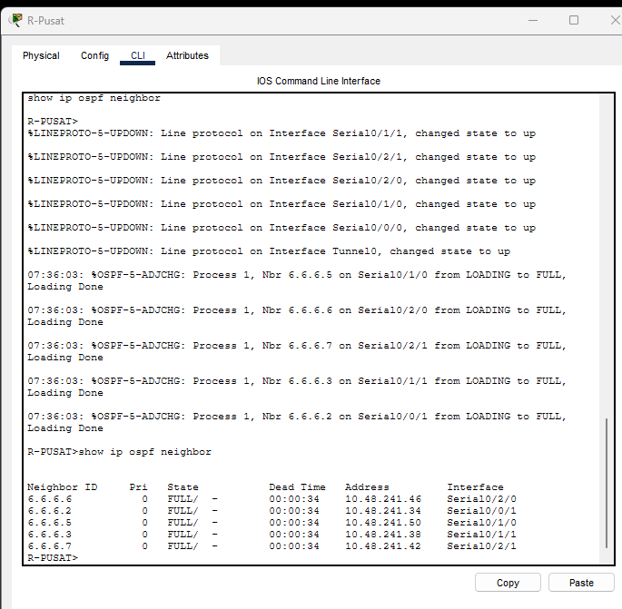
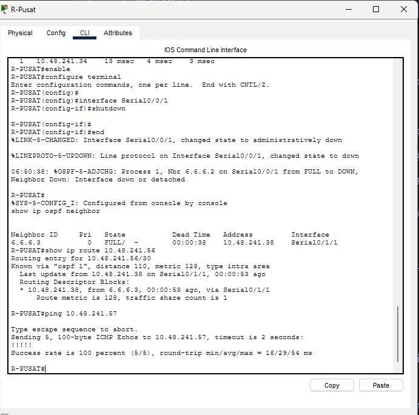
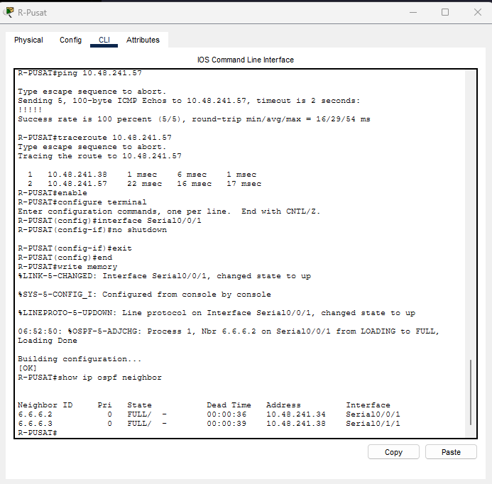

# Pengujian VLSM OSPF

## 1. Verifikasi Neighbor & Tabel Routing OSPF (di `R-PUSAT`)

```cisco
show ip ospf neighbor
show ip route ospf
```

Pastikan kelima tetangga langsung (`6.6.6.2`, `6.6.6.3`, `6.6.6.5`, `6.6.6.6`, `6.6.6.7`) berstatus **`FULL`**. Untuk rute yang dipelajari melalui OSPF, perhatikan kode **`O`** pada tabel routing (rute yang lebih spesifik dan static route dapat memiliki kode lain).

**Bukti lima neighbor OSPF berstatus FULL pada R-PUSAT:**



> **Catatan:** Gambar menunjukkan status neighbor OSPF. Bukti terpisah berupa keluaran `show ip route ospf` belum tercantum dalam kumpulan screenshot ini.

## 2. Putuskan Link Utama `L1` (di `R-PUSAT`)

```cisco
enable
configure terminal
interface Serial0/0/1
shutdown
end
```

Interface `Serial0/0/1` menghubungkan R-PUSAT ke R-DC melalui link L1. Tunggu konvergensi OSPF setelah link dimatikan.

## 3. Uji Perpindahan Jalur Otomatis (*Failover*)

Di CLI `R-PUSAT`, jalankan:

```cisco
show ip route 10.48.241.56
ping 10.48.241.57
traceroute 10.48.241.57
```

Alternatif dari Command Prompt `PC-PEGAWAI-BK`: `tracert 10.48.239.2`.

Jalur alternatif diharapkan melewati **R-UTARA** (`10.48.241.38`) → **L7 / R-DC** (`10.48.241.57`), kemudian menuju jaringan server DC bila tujuannya `10.48.239.2`.

**Bukti pengujian failover — routing/ping jalur alternatif:**



**Bukti traceroute dan pemulihan L1:**



> **Catatan:** Dua screenshot failover ini berasal dari pengujian file C sebelumnya, bukan pengujian ulang yang terverifikasi pada file gabungan OSPF teman B.

## 4. Pulihkan Kembali Link `L1` Setelah Uji (wajib di `R-PUSAT`)

```cisco
enable
configure terminal
interface Serial0/0/1
no shutdown
end
write memory
```

Pastikan neighbor `6.6.6.2` kembali **`FULL`** dengan perintah `show ip ospf neighbor`. Simpan file `.pkt` sesudah link berhasil pulih.
