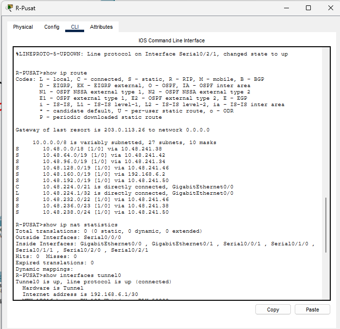
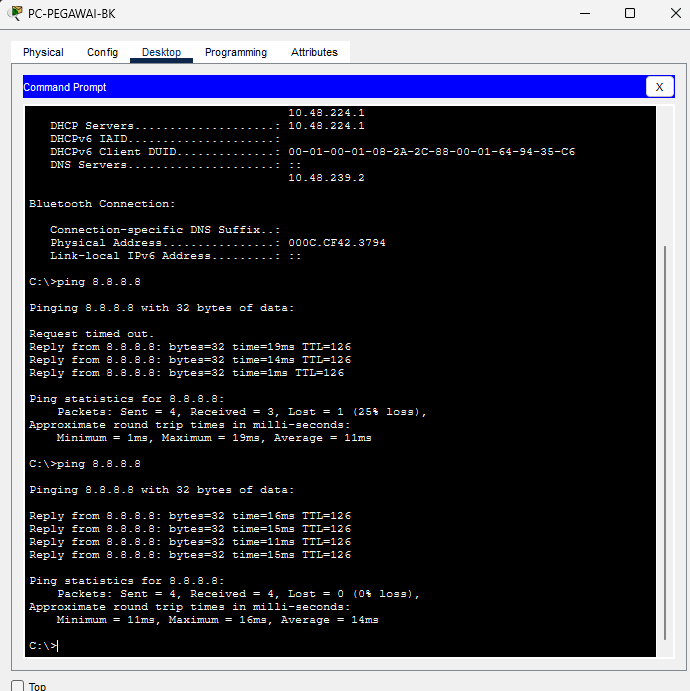
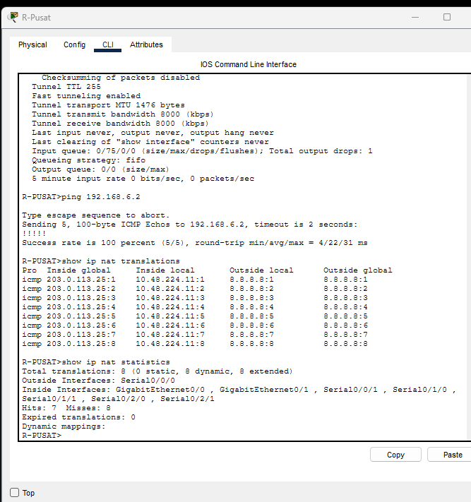
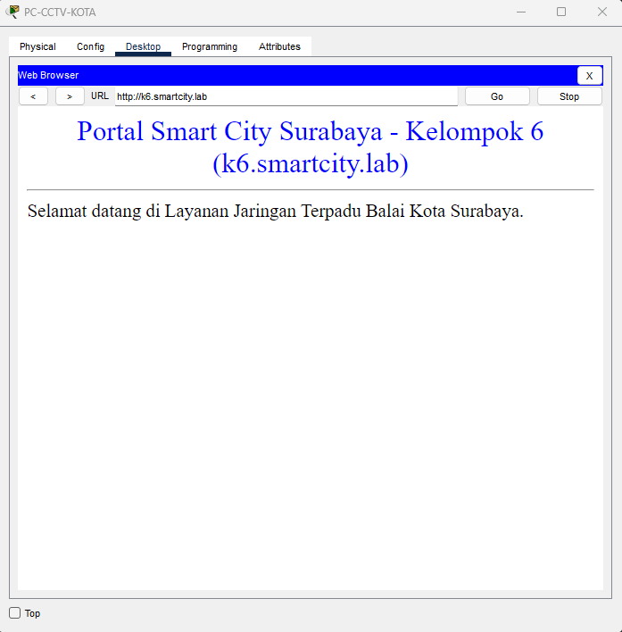
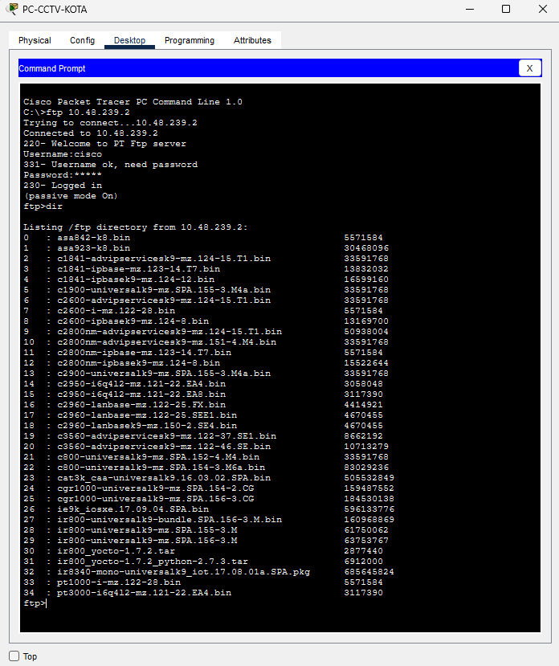
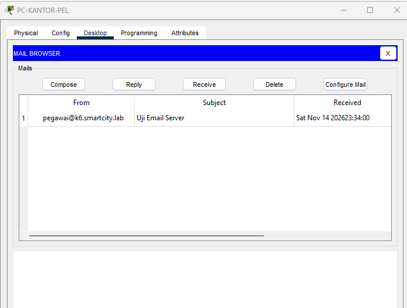
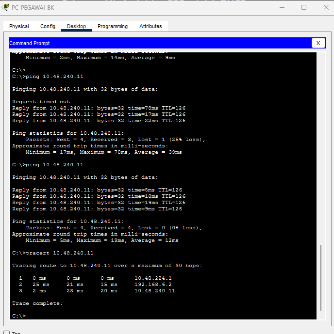

# Pengujian VLSM

## 1. Uji Konektivitas & Static Routing

Dari `PC-PNS-B` → **Desktop → Command Prompt**, jalankan:

- `ping 10.48.238.1` (gateway `R-BARAT`)
- `ping 10.48.224.1` (core `R-PUSAT`)
- `ping 10.48.239.2` (`SRV-DC`)
- `ping 10.48.241.2` (`SRV-BALAIKOTA`)
- `ping 10.48.240.11` (`PC-KANTOR-PEL`, lintas cabang)

**Bukti yang tersedia — tabel static routing R-PUSAT:**



> **Catatan:** Gambar membuktikan tabel routing R-PUSAT, bukan kelima hasil ping dari `PC-PNS-B`. Screenshot ping tersebut perlu ditambahkan bila ingin membuktikan semua tujuan di atas.

## 2. Uji NAT Overload ke Internet

- Dari `PC-PNS-B`, jalankan `ping 8.8.8.8` (harus *Reply*).
- Pada CLI `R-PUSAT`, jalankan `show ip nat translations`. Pastikan IP privat diterjemahkan ke IP publik `203.0.113.25`.

**Bukti ping internet yang tersedia — dari `PC-PEGAWAI-BK` (`10.48.224.11`):**



**Bukti translasi NAT pada `R-PUSAT`:**



> **Catatan:** Screenshot NAT menggunakan sumber `PC-PEGAWAI-BK`, bukan `PC-PNS-B` yang tercantum dalam prosedur. Fungsi NAT PAT terbukti pada PC yang diuji, tetapi pengujian khusus `PC-PNS-B` belum didokumentasikan.

## 3. Uji DNS & Web Server

- Dari `PC-CCTV-KOTA` (atau PC lain), buka **Desktop → Web Browser**.
- Masukkan `http://k6.smartcity.lab` dan klik **Go**. Pastikan halaman HTML Portal Smart City muncul.



## 4. Uji FTP Server (`SRV-DC`)

- Dari Command Prompt pada PC mana saja, ketik `ftp 10.48.239.2` (atau `ftp dc.k6.smartcity.lab`).
- Masukkan username `cisco` dan password `cisco`, kemudian ketik `dir` untuk menampilkan daftar file server.



## 5. Uji Email Server (`SRV-BALAIKOTA`)

- Di `PC-PNS-B`, buka **Desktop → Email**, lalu isi *Your Name*: `Pegawai`, *Email Address*: `pegawai@k6.smartcity.lab`, *Incoming & Outgoing Mail Server*: `10.48.241.2`, *User Name*: `pegawai`, *Password*: `123`. Klik **Save**.
- Lakukan hal serupa di `PC-KANTOR-PEL` menggunakan `pelabuhan@k6.smartcity.lab`, username `pelabuhan`, password `123`.
- Dari `PC-PNS-B`, klik **Compose**, kirim email ke `pelabuhan@k6.smartcity.lab`, lalu klik **Receive** di `PC-KANTOR-PEL`.



## 6. Uji Tunnel GRE

Dari `PC-PEGAWAI-BK` → **Desktop → Command Prompt**, jalankan:

```cmd
tracert 10.48.240.11
```

Urutan *hop* yang diharapkan adalah `10.48.224.1` → `192.168.6.2` → `10.48.240.11` (tidak melewati alamat IP R-UTARA pada tampilan traceroute).

**Bukti GRE — traceroute PC Balai Kota ke Pelabuhan:**


